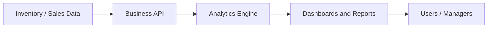

# Business-Enterprise-inteligence-platform

A business intelligence and operations platform concept for tracking sales, costs, inventory, suppliers, and profitability for small and growing businesses.

## Overview

This repository currently contains only a placeholder README and no application code, database schema, or configured backend. Based on the project description, the intended system is a business analytics platform designed to help operators understand sales, stock levels, supplier records, costs, and profit performance.

The project is best treated as a concept and early planning repository rather than a completed application.

## Problem statement

Small businesses often struggle to track sales performance, inventory movement, supplier spending, and profit margins in a single place. A practical business intelligence tool could help operators spot revenue trends, identify slow-moving stock, compare costs against sales, and improve decision-making.

## Key features

### Implemented and verified

- No verified application code was found in this repository.
- No backend, frontend, database migrations, tests, or deployment configuration were identified.

### Partially implemented

- None confirmed in the current repository.

### Planned

- Sales and revenue dashboards.
- Inventory and stock tracking.
- Purchase and supplier records.
- Cost and profit calculations.
- Product performance analysis.
- Daily, weekly, monthly, and annual reports.
- Charts, exports, and business summaries.
- User roles such as administrator, manager, and staff.
- Multi-branch support as a possible future feature.
- Data import and export.
- Alerts for low stock or unusual performance.
- Optional forecasting and anomaly detection.

## Technology stack

| Technology | Current use in repo | Planned use | Status |
| --- | --- | --- | --- |
| Python | Not present | Backend services, analytics logic, reporting | Planned |
| JavaScript / frontend framework | Not present | Dashboard UI, charts, filters | Planned |
| Relational database | Not present | PostgreSQL or MySQL for transactions and analytics | Planned |
| FastAPI or similar backend | Not present | API layer for dashboard and business operations | Planned |
| Excel / CSV import | Not present | Data import workflows | Planned |
| Reporting tools | Not present | Charts, summary exports, and business reports | Planned |
| Docker / deployment tooling | Not present | Environment setup and deployment | Planned |

## System architecture

The repository does not yet provide an implementation architecture. A reasonable proposed structure would include:

- A data layer for business records such as products, purchases, sales, and stock.
- An application layer for validation, aggregations, and reporting.
- A dashboard layer for managers and staff users.
- A security layer with role-based access controls.

## Project structure

The repository currently contains only a placeholder `README.md`.

## Installation and setup

No runnable setup instructions are available because no application code has been added.

## Configuration

No environment variables or configuration files were found.

## How to use

This project is not yet runnable. The intended workflow is a proposed business dashboard and analytics process, but it has not been implemented in the codebase.

## Database design

### Proposed

A relational database is a reasonable fit for this project. Planned entities may include:

- products
- suppliers
- purchases
- sales
- inventory movements
- customers
- staff or users
- cost records
- reports and audit logs

Important design requirements:

- Data validation for quantities and prices.
- Role-based access to sensitive operations.
- Historical records for sales and stock movement.
- Correct accounting and aggregation logic.

## Security and privacy

- Role-based access should be implemented before live business data is used.
- Financial and supplier data should be protected with access controls.
- Audit history should be maintained for changes to transactions and pricing.
- This repository does not yet demonstrate enterprise-grade security controls.

## Testing

No automated tests or verification evidence were found.

## Roadmap

### Phase 1: Foundation
- [ ] Define core business entities and data model.
- [ ] Decide stack for backend and dashboard.
- [ ] Set up project structure and code conventions.

### Phase 2: Core functionality
- [ ] Build product, inventory, and sales records.
- [ ] Add purchasing and supplier modules.
- [ ] Implement cost and profit calculations.

### Phase 3: Advanced functionality
- [ ] Add dashboards and summary reports.
- [ ] Add export and charting features.
- [ ] Add alerts for low stock and unusual trends.

### Phase 4: Testing, deployment, and documentation
- [ ] Add automated tests for calculations and reporting.
- [ ] Validate workflows with realistic sample data.
- [ ] Document installation and deployment instructions.

### Phase 5: Optional monetization and business development
- [ ] Define pricing for small business use.
- [ ] Offer installation and customization packages.
- [ ] Add premium reporting or analytics modules.
- [ ] Create onboarding and training workflows.

## Business and monetization potential

This project concept could be commercialized as:

- monthly subscriptions for small businesses,
- paid setup and customization,
- premium analytics and reporting packages,
- training and maintenance contracts.

These are product ideas, not confirmed revenue streams.

## Limitations and future improvements

- No production requirements or data model are implemented yet.
- No frontend or backend structure exists in the repository.
- No validation of performance, deployment strategy, or data volume requirements is available.

## Contributing

This repository is in the early planning stage. Contributions should focus on clarifying the system architecture, business rules, and data model before implementation begins.

## License

License not yet specified.

## Author

GitHub: `smigoh`

## Development Notes

- Current status: concept and planning stage only.
- Languages planned: Python, JavaScript, SQL.
- Database choice: relational database is the natural choice for inventory and reporting.
- Future priorities: define the data model, API, and dashboard flow.
- Most important next step: decide the core business workflow and build a minimal prototype with sample data.
